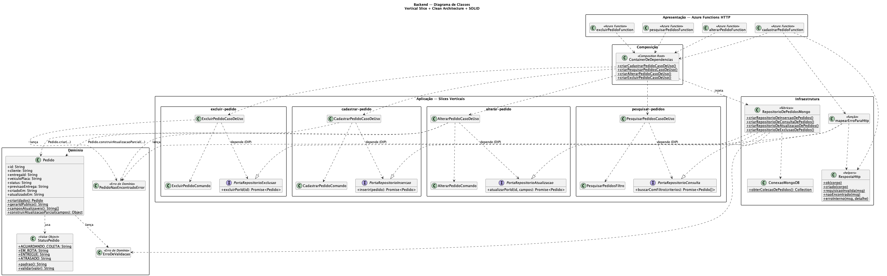
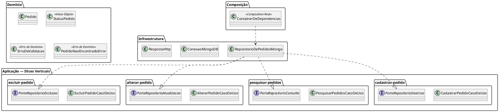
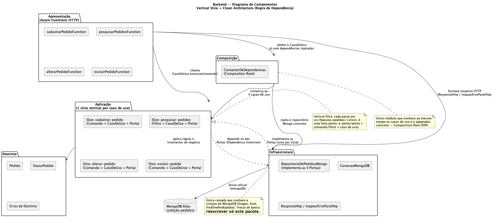
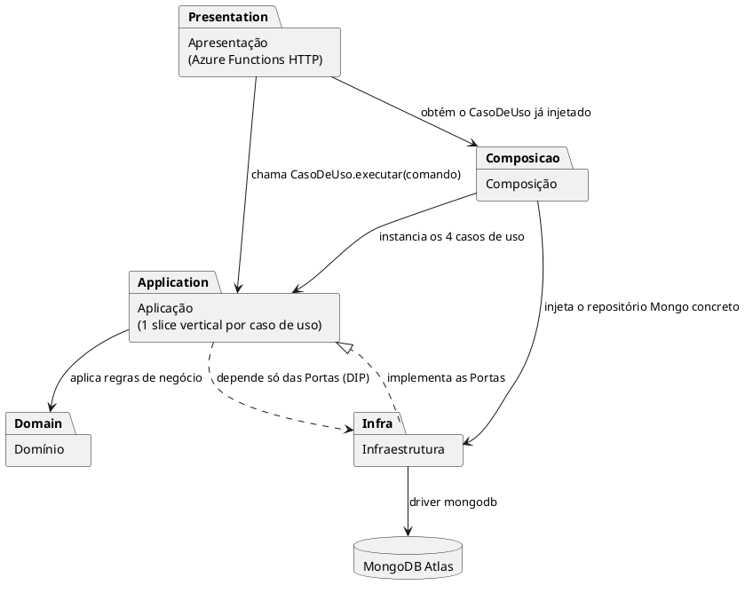

# Arquitetura do Backend — Vertical Slice + Clean Architecture + SOLID

> Refatoração do backend (Azure Functions, Node.js v4) do CRUD de pedidos
> (RF05/RF07), de 4 arquivos "flat" em `api/src/functions/*.js` para uma
> organização em **Vertical Slice Architecture** com camadas internas de
> **Clean Architecture**, aplicando os 5 princípios **SOLID**. Nenhum
> contrato HTTP mudou — o frontend continua funcionando sem alterações.

## 1. Por que Vertical Slice + Clean Architecture juntas

- **Vertical Slice**: o backend é organizado por *caso de uso* (feature),
  não por camada técnica. Cada operação do CRUD — cadastrar, pesquisar,
  alterar, excluir — vive numa pasta própria em
  `api/src/features/pedidos/<slice>/`, com tudo que ela precisa: o
  adaptador HTTP, o comando/filtro de entrada, o caso de uso e a porta
  (interface) que ele exige do repositório.
- **Clean Architecture** entra *dentro* de cada slice e no projeto como um
  todo, através da **Regra de Dependência**: código de fora (Azure
  Functions, MongoDB) nunca é importado pelo código de dentro (Domínio,
  Aplicação). Infraestrutura implementa portas; nunca o contrário.
- **SOLID** é a técnica usada para que as duas coisas acima realmente se
  sustentem — ver seção 3.

## 2. Estrutura de pastas

```
api/src/
├── dominio/                          # Camada mais interna (sem dependências externas)
│   ├── Pedido.js                     # Entidade rica: Pedido.criar(), gerarIdPublico(), construirAtualizacaoParcial()
│   ├── StatusPedido.js               # Value Object (enum fechado de status)
│   └── erros/
│       ├── ErroDeValidacao.js        # → mapeado para HTTP 400
│       └── PedidoNaoEncontradoError.js  # → mapeado para HTTP 404
│
├── features/pedidos/                 # Vertical Slices (1 pasta por caso de uso)
│   ├── cadastrar-pedido/             # POST   /api/pedidos
│   ├── pesquisar-pedidos/            # GET    /api/pedidos
│   ├── alterar-pedido/               # PUT    /api/pedidos/{id}
│   └── excluir-pedido/               # DELETE /api/pedidos/{id}
│       # cada slice contém:
│       #   Porta*.js        → interface (Dependency Inversion + Interface Segregation)
│       #   *Comando.js / *Filtro.js → DTO de entrada
│       #   *CasoDeUso.js    → orquestração (camada de Aplicação)
│       #   *Function.js     → adaptador HTTP (camada de Apresentação)
│
├── infraestrutura/                   # Camada mais externa (detalhes de implementação)
│   ├── persistencia/
│   │   ├── ConexaoMongoDB.js         # conexão cacheada (igual ao antigo mongoClient.js)
│   │   └── RepositorioDePedidosMongo.js  # implementa as 4 portas
│   └── http/
│       ├── RespostaHttp.js           # respostas padronizadas + CORS
│       └── mapearErroParaHttp.js     # erro de domínio → status HTTP
│
└── composicao/
    └── ContainerDeDependencias.js    # Composition Root: injeta Mongo nos casos de uso

api/tests/                            # 19 testes de unidade (node:test), sem Mongo:
├── dominio/Pedido.test.js            # repositórios falsos (fakes) em memória
└── features/*.test.js
```

## 3. SOLID aplicado

| Princípio | Onde | Como |
|---|---|---|
| **S** — Single Responsibility | `Pedido` só tem regra de negócio; `*Comando`/`*Filtro` só transportam dados; `*CasoDeUso` só orquestra; `*Function` só traduz HTTP; `RespostaHttp` só formata resposta | Cada classe muda por **um único motivo** |
| **O** — Open/Closed | `mapearErroParaHttp.js` | Novo tipo de erro de domínio = um novo `if` nesse arquivo; nenhuma das 4 Functions precisa ser tocada |
| **L** — Liskov Substitution | Qualquer objeto que satisfaça uma `Porta*` (ex.: o repositório falso usado nos testes) pode substituir `RepositorioDePedidosMongo` sem quebrar o caso de uso | Validado nos 19 testes, que usam fakes em vez do Mongo real |
| **I** — Interface Segregation | 4 portas pequenas (`PortaRepositorioInsercao`, `Consulta`, `Atualizacao`, `Exclusao`), uma por slice, cada uma com **um único método** | Em vez de um repositório genérico com os 4 métodos de CRUD, cada caso de uso só enxerga o método que usa |
| **D** — Dependency Inversion | `*CasoDeUso` depende só da `Porta*` (abstração); `composicao/ContainerDeDependencias.js` é o único módulo que conhece a implementação concreta (MongoDB) e faz a injeção | Trocar de banco = reescrever só `infraestrutura/persistencia/RepositorioDePedidosMongo.js` |

## 4. Diagrama de Classes



*Fonte: [`diagramas/backend-classes.puml`](diagramas/backend-classes.puml) — PlantUML.*



## 5. Diagrama de Componentes



*Fonte: [`diagramas/backend-componentes.puml`](diagramas/backend-componentes.puml) — PlantUML.*



## 6. Compatibilidade mantida

A refatoração é comportamental-neutra no contrato HTTP: mesmas rotas
(`/api/pedidos`, `/api/pedidos/{id}`), mesmos métodos, mesmos status code
(`200`/`201`/`400`/`404`/`500`), mesmo formato de corpo e mesmo cabeçalho
`Access-Control-Allow-Origin: *`. A única mudança de comportamento
deliberada: o campo `status` agora é validado contra o conjunto fechado já
usado pela UI (`Aguardando coleta`, `Em rota`, `Entregue`, `Atrasado` —
ver `StatusPedido`), o que antes só era garantido no frontend.

## 7. Testes

19 testes de unidade (`node --test`), sem nenhuma dependência de MongoDB ou
Azure Functions — cada caso de uso é testado com um repositório **falso**
(fake) em memória que satisfaz só a porta exigida:

```
cd api && npm test
```

Isso também reduz o risco **R04** do documento Arc42 (seção 11 —
"Sem testes automatizados").
